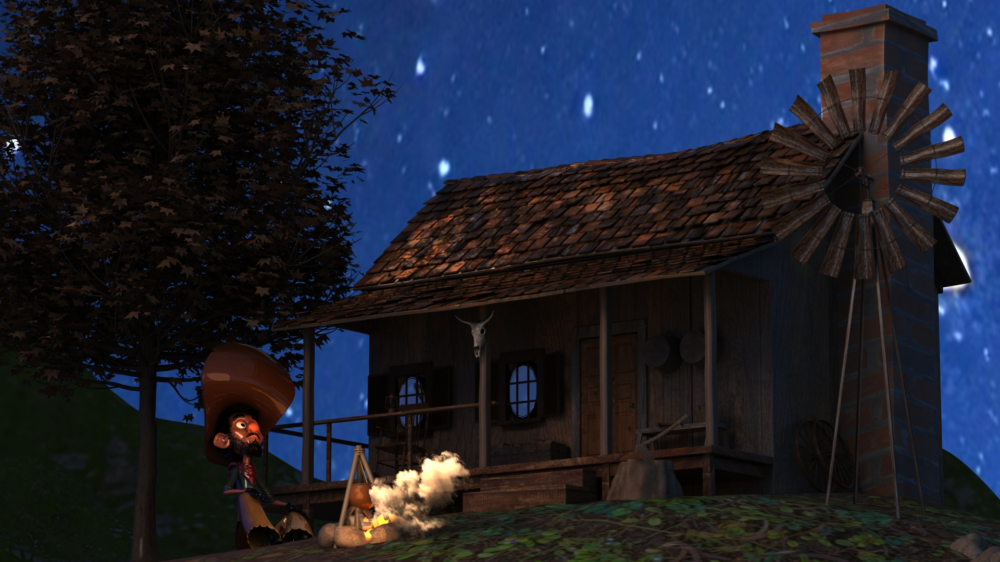
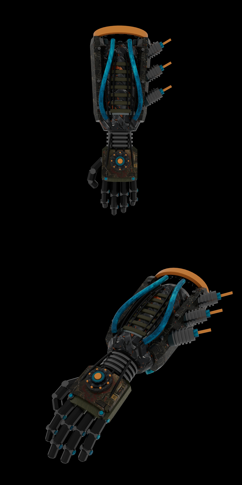

# Hola, soy Johanna Romero 👋

**Desarrolladora Full Stack JavaScript · Estudiante de Ingeniería en Animación 3D · Creatividad digital**

Soy desarrolladora Full Stack JavaScript y estudiante de Ingeniería en Animación 3D en AIEP. Me interesa combinar programación, diseño y narrativa visual para crear experiencias digitales funcionales y cuidadas.

En este espacio comparto mis proyectos y aplico mis conocimientos de frontend, backend y bases de datos.

## 💻 Proyectos destacados

### CreativeFlow Backend
API REST para gestionar usuarios y proyectos, con autenticación JWT, operaciones CRUD y carga de imágenes.

**Tecnologías:** Node.js · Express · PostgreSQL · Sequelize

[Ver repositorio](https://github.com/Zkeh-x7/creativeflow-backend)

### Alke Wallet
Simulación de una billetera digital con depósitos, transferencias, contactos e historial de movimientos.

**Tecnologías:** HTML · CSS · JavaScript · Bootstrap · jQuery

[Ver repositorio](https://github.com/Zkeh-x7/alke-wallet)

### Portafolio digital
Presentación de mi perfil, proyectos y caso de estudio de CreativeFlow.

**Tecnologías:** Next.js · React · TypeScript

[Ver portafolio](https://zkeh-x7.github.io) · [Ver código](https://github.com/Zkeh-x7/zkeh-x7.github.io)

## 🛠️ Herramientas y conocimientos

- **Frontend:** HTML, CSS, JavaScript, Bootstrap y jQuery.
- **Backend y datos:** Node.js, Express, PostgreSQL y Sequelize.
- **Flujo de trabajo:** Git, GitHub y Visual Studio Code.
- **Producción 3D:** Autodesk Maya, Mudbox y Arnold.
- **Diseño y audiovisual:** Photoshop, Illustrator, Premiere Pro, After Effects y Audition.

## 🎨 Arte y tecnología

Mi formación en animación 3D incluye modelado, texturizado, rigging, skinning, sincronización labial, iluminación y renderizado. Me interesa aportar esta perspectiva visual al desarrollo de proyectos digitales.

Busco oportunidades para seguir aprendiendo y colaborar en proyectos de desarrollo web, animación y producción audiovisual.

## 🖼️ Galería de proyectos 3D

### Escenario exterior
Trabajo de iluminación y renderizado realizado en Autodesk Maya con Arnold.

### Brazo robótico
Presentación de mi proyecto de brazo robótico en 3D.

### Animación 3D

https://github.com/user-attachments/assets/139d9572-a407-4ef9-911f-135a7c0cba1e
